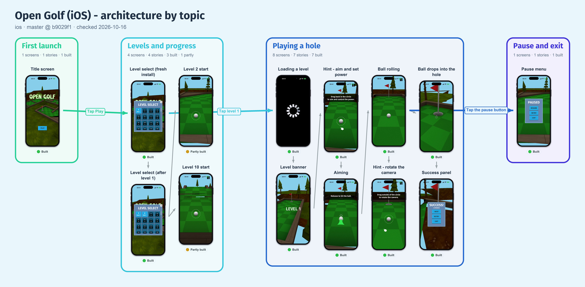

# user-story-maps

Keep your app's topics, personas, flows, screens and user stories in one `stories.yaml`. One command turns it into a story map with real screenshots, topic swimlanes and the app's own look. It writes a `REPORT.md`, a clickable HTML viewer, an architecture-by-topic image and a one-pager. It uses free tools only (Python 3, optional Pillow), and nothing leaves your machine.


*[Wikipedia iOS](https://github.com/wikimedia/wikipedia-ios): unofficial illustration, not affiliated with the Wikimedia Foundation, MIT ([notices](THIRD-PARTY-NOTICES.md)).*



*[Open-Golf](https://github.com/mgerdes/Open-Golf): unofficial illustration, not affiliated with its author, MIT, art credits in [notices](THIRD-PARTY-NOTICES.md).*

## Quick start
```bash
python3 scripts/storymap.py build examples/wikipedia-ios           # real-app example (dark)
python3 scripts/storymap.py build examples/open-golf               # real-app example (light)
python3 scripts/storymap.py init docs/story-map --agents           # your app: stories.yaml, screens/, .gitignore
python3 scripts/storymap.py theme-from path/to/app/source          # optional: draft theme: from the app's tokens
python3 scripts/storymap.py validate docs/story-map && python3 scripts/storymap.py build docs/story-map
```
Agents only keep the map current if `AGENTS.md` (or `CLAUDE.md`) tells them to. The block has markers, so running the command again updates it and never overwrites your text.

If neither file exists, use `--agents AGENTS.md` to create one. Agents should read [`skills/user-story-maps/SKILL.md`](skills/user-story-maps/SKILL.md).

## Output
The default `lean` profile writes these to `generated/`:

| File | Contents |
|---|---|
| `REPORT.md` | The text output: status counts, topics, every story once (evidence, screens), gaps by severity |
| `story-map.html` | One file under 2 MB with filters and search. Click a story or screen for details |
| `architecture.png` | Screens in device frames, coloured topic swimlanes, cross-topic arrows |
| `one-pager.png` | Status, topic map, top gaps, every screen |

Add more with `--formats +name` or `--profile full`: `pdf`, `crops` (per-topic architecture crops), `flows`, `overview`, `flow-map`, `csv`, `mermaid`, `dot`, `legacy-md`. `--clean` removes superseded files in `generated/`. Details: [`references/outputs.md`](skills/user-story-maps/references/outputs.md).

## What it does
- Every flow belongs to a topic. The swimlanes show how the app is structured and where users cross between areas.
- `theme-from` scans the app's design tokens for a draft palette and font. Only `primary` is required, and every output uses the result.
- Dark mode: set `background: "#000000"` or `mode: dark`, and the page, lanes, text, colours and frames follow.
- Each screenshot gets a device frame (iPhone, Android, tablet or browser), auto-detected and drawn with Pillow. No artwork is bundled, and no white cards sit behind devices.
- Branching flows draw one trunk, an orthogonal bus and aligned children.
- Image outputs draw each screenshot at its native pixels or larger, so zooming keeps the text readable. Only the HTML embeds reduced copies (up to 480 px).
- Story status is `built`, `partly`, `unverified` or `missing`. `built` requires `verified:` (how and when). The validator also warns about over-long and repeated text.

Rules and options: [`looks.md`](skills/user-story-maps/references/looks.md), [`theme.md`](skills/user-story-maps/references/theme.md).

## Examples
| Example | Contents |
|---|---|
| [`examples/wikipedia-ios/`](examples/wikipedia-ios/) | Wikipedia iOS app, dark theme |
| [`examples/open-golf/`](examples/open-golf/) | Open-Golf game, light theme |

## Layout
```
skills/user-story-maps/SKILL.md    workflow, schema, rules (+ references/: outputs, looks, theme, frames, capture)
scripts/storymap.py                the generator (one file; stdlib + optional Pillow/PyYAML/Graphviz)
scripts/capture/                   screenshot helpers: iOS Simulator, Android emulator, web (Playwright)
templates/                         stories.yaml skeleton, AGENTS.md snippet, .gitignore snippet
examples/                          wikipedia-ios, open-golf
tests/                             python3 -m unittest discover -s tests; tiny fixture in fixtures/
```
`init` does not copy `storymap.py` into your repo. `init --vendor` does.

## Requirements
Python 3.8+. Optional: `pillow` (images, frames, one-pager), `pyyaml`, Graphviz, mermaid-cli, and `fonttools` + `brotli` for `--embed-fonts`. The tests skip their numpy checks when `numpy` is missing. A font with `google_font: true` is cached in `~/.cache/storymap/fonts`, never in the repo.

## Privacy and third-party content
Screenshots and stories end up in your repo, so use a demo account and fake data, and keep credentials and session files out. For someone else's app, add `app.disclaimer` and check the screenshot licence ([`examples/wikipedia-ios/README.md`](examples/wikipedia-ios/README.md), [`THIRD-PARTY-NOTICES.md`](THIRD-PARTY-NOTICES.md)).

## License
MIT, see [LICENSE](LICENSE). Example screenshots show third-party content under its own terms.
