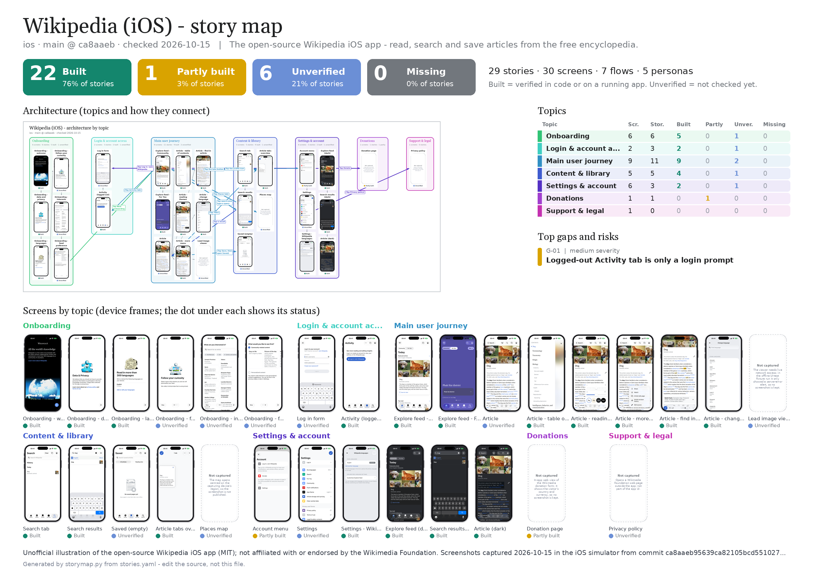

# story-map-skill

**One editable file → a full story map of your app, with real screenshots, topic areas and the app's own look.** Keep topics, personas, flows, screens and user stories in a single `stories.yaml`; one command regenerates the story tables (grouped by topic), per-flow diagrams (screenshots as nodes), an **architecture-by-topic** diagram, a Mermaid map for GitHub, a clickable HTML viewer and a PDF one-pager. The generated map is styled from an optional `theme:` (palette + font) so it looks like the app it documents. Free tools only: Python 3, optional Pillow / Graphviz / Mermaid. Nothing leaves your machine.


*Architecture of the [Wikipedia iOS](https://github.com/wikimedia/wikipedia-ios) app, generated from [`examples/wikipedia-ios/stories.yaml`](examples/wikipedia-ios/stories.yaml): real simulator screenshots grouped in topic swimlanes, thick arrows where users cross between topics. Unofficial illustration of the open-source Wikipedia iOS app (MIT); not affiliated with or endorsed by the Wikimedia Foundation. Screenshots captured 2026-10-15 in the iOS simulator from commit `ca8aaeb95639ca82105bcd5510277d8dde0e420e`; trademarks and content belong to their owners (Wikipedia content CC BY-SA).*



## Examples
| Example | What it shows |
|---|---|
| [`examples/wikipedia-ios/`](examples/wikipedia-ios/) | **A real mobile app**: the open-source Wikipedia iOS app built from source and captured in the iOS simulator. 7 topics, 30 screens (26 real screenshots, incl. dark theme), 29 stories (22 built / 1 partly / 6 unverified), 5 gaps. Theme taken from the app's own design tokens. |
| [`examples/plant-waterer/`](examples/plant-waterer/) | Tiny fictional quickstart with mock screens (16 stories, 4 topics). |

## Try it
```bash
python3 scripts/storymap.py build examples/plant-waterer      # the quickstart example
python3 scripts/storymap.py build examples/wikipedia-ios      # the real-app example
open examples/wikipedia-ios/generated/story-map.html          # Architecture tab, topic / status / persona filters, click to enlarge
```

## Use it in your app
```bash
python3 scripts/storymap.py init docs/story-map     # stories.yaml + screens/ + generated/ + vendored storymap.py
# edit docs/story-map/stories.yaml: topics, flows (each with a topic), screens, stories
python3 scripts/storymap.py theme-from path/to/app/source   # optional: read the app's colours/fonts, paste the draft theme: block
python3 docs/story-map/storymap.py validate         # missing screens/screenshots, duplicate ids, flows without a topic, ...
python3 docs/story-map/storymap.py build            # regenerates everything
```
Then add [`templates/AGENTS-snippet.md`](templates/AGENTS-snippet.md) to your repo's `AGENTS.md` so coding agents keep the map updated as part of "done".

## Topics: see how the app is architected
Every flow belongs to a **topic** (recommended set: onboarding, login/account access, main user journey, content/library, settings & account, payments/subscription, support/legal). The generator draws screens in coloured topic swimlanes with the cross-topic arrows highlighted (`architecture.png`, also as Mermaid subgraphs on GitHub), adds a topic summary table (screens, stories, status counts), a topic filter in the HTML viewer, and groups the stories by topic.

## Theme: the map follows the app's design
An optional `theme:` block (`primary`, text/surface/border colours, font family, explicit status/severity colours) styles every output - HTML viewer, one-pager, flow and architecture PNGs, Mermaid. Only `primary` is needed: status, severity and topic colours are derived from it. `storymap.py theme-from <app source>` scans the app's code for design tokens. Light background always. Only open-licensed fonts are ever fetched or bundled; proprietary families are referenced by name with a fallback.

## Device mockups: screenshots look like the real device
Every screenshot is rendered inside a device frame (Dynamic Island / notch / home-button iPhone, Android, tablet, browser window; rotated for landscape) in every output. The whole screenshot is always visible (aspect ratio preserved, never cropped). Status is a small badge under the device instead of a coloured border; screens that were not captured are a dashed empty device outline with the reason. Frames are drawn with Pillow, so no third-party artwork is bundled; the model is auto-detected from the screenshot and can be set per screen (`device:`), per app, or in `theme.device` (`style: black | titanium | light`). You may plug in your own frame PNG through `frames.json`, but never commit it (see [THIRD-PARTY-NOTICES.md](THIRD-PARTY-NOTICES.md) for why none is bundled).

## Flow diagrams read as trees
Where one screen leads to several screens, the flow diagram draws a tree: a single trunk leaves the parent, branches with orthogonal elbows, and the children sit on one aligned row (or column, when the flow runs left to right), evenly spaced and centred on the parent. Linear steps stay straight arrows.

## What you get
| Output (in `generated/`) | |
|---|---|
| `architecture.png` | screens (in device frames) grouped in topic swimlanes, cross-topic arrows, topic summary on the one-pager |
| `story-map.html` | one self-contained file; Architecture tab, topic/status/persona filters, search, click-to-enlarge screens |
| `one-pager.pdf` / `.png` | A3 overview: status counts, topic table, architecture, top gaps, every screen |
| `flows/<flow>.png`, `overview.png`, `flow-map.png` | diagrams with real screenshots as nodes, arrows labelled with the action; branches drawn as aligned trees |
| `story-map.md` + `mermaid/*.mmd` | topic table + Mermaid architecture; renders directly on GitHub |
| `user-stories.md` / `.csv`, `gaps-and-risks.md` | stories grouped by topic (Topic column in the csv), risks by severity |

Example flow diagram: [`examples/wikipedia-ios/generated/flows/reading.png`](examples/wikipedia-ios/generated/flows/reading.png).

## Honest by design
Statuses are `built · partly · unverified · missing`. A story can only be `built` with a `verified:` note (how and when you checked it in code or on a running app); otherwise it is `unverified`. The validator enforces this. The Wikipedia example marks only what was seen in the simulator as built and lists what it did not check.

## Layout
```
skills/user-story-maps/SKILL.md   the skill: workflow, schema, rules, theme, looks, capture, dependencies (terse)
skills/user-story-maps/references/ own device frames (frames.md), capture details (capture-details.md)
scripts/storymap.py               the generator (single file, standard library + optional Pillow/Graphviz/PyYAML)
scripts/capture/                  screenshot helpers: iOS Simulator, Android emulator, web (Playwright)
templates/                        stories.yaml skeleton (standard topics, theme, device), AGENTS.md snippet, .gitignore snippet
THIRD-PARTY-NOTICES.md            frame/font/content licences and why no device artwork is bundled
examples/wikipedia-ios/           real mobile example: source, screenshots, capture test, outputs, licence notes
examples/plant-waterer/           tiny fictional quickstart: source, mock screens, generated outputs
tests/                            python3 -m unittest discover -s tests
```

## Requirements
Python 3.8+. Optional: `pip install pillow` (images, device frames, PDF, architecture diagram), Graphviz (`dot`, better flow layout; a built-in renderer is the fallback), `pip install pyyaml` (full YAML), mermaid-cli (render `.mmd` to PNG). Fonts named in `theme:` are used if installed; with `google_font: true` an open-licensed Google Font is downloaded once into `~/.cache/storymap/fonts` (never into the repo).

## Privacy and third-party content
Screenshots and stories end up in your repo. Capture with a demo account and fake data only; never commit credentials or session files. If you document someone else's app, add a disclaimer (`app.disclaimer`) and check its licence for the screenshots (see `examples/wikipedia-ios/README.md`). See the capture guide in the skill.

## License
MIT - see [LICENSE](LICENSE). Example screenshots show third-party content under its own terms (see the example's README).
