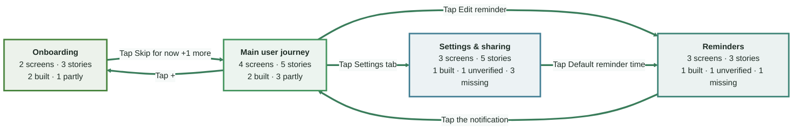
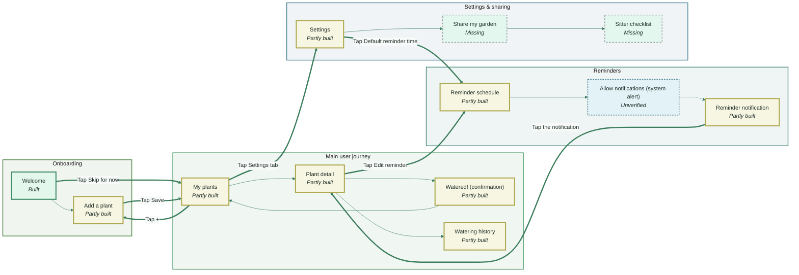
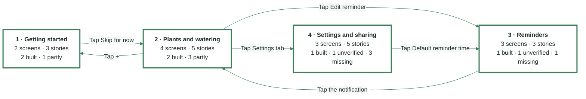
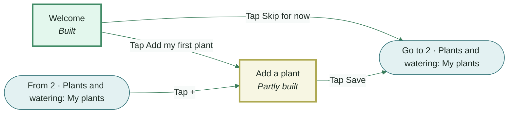
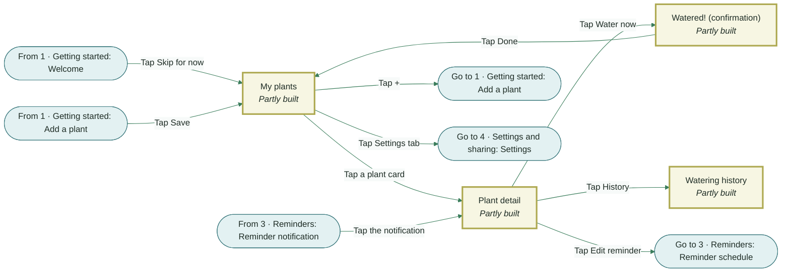
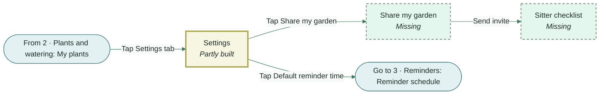

# Plant Waterer - story map

_Generated from `stories.yaml`. The diagrams below render on GitHub. Screens with real screenshots are in `flows/` (PNG) and `story-map.html`._

**ios · demo build 1.0 · checked 2026-10-15**

Status: 🟢 built · 🟠 partly · 🟣 unverified · ⚪ missing

## Architecture by topic

Each box is a topic area; arrows show how users move between them.

| Topic | Screens | Stories | 🟢 built | 🟠 partly | 🟣 unverified | ⚪ missing | Flows |
|---|---|---|---|---|---|---|---|
| **Onboarding** | 2 | 3 | 2 | 1 | 0 | 0 | 1 · Getting started |
| **Main user journey** | 4 | 5 | 2 | 3 | 0 | 0 | 2 · Plants and watering |
| **Reminders** | 3 | 3 | 1 | 0 | 1 | 1 | 3 · Reminders |
| **Settings & sharing** | 3 | 5 | 1 | 0 | 1 | 3 | 4 · Settings and sharing |

### Screens grouped by topic

## Story map (personas x flows)

| Persona | 1 · Getting started | 2 · Plants and watering | 3 · Reminders | 4 · Settings and sharing |
|---|---|---|---|---|
| **Busy gardener** |  | 🟢 US-04 🟢 US-05 🟠 US-06 🟠 US-11 | 🟢 US-07 ⚪ US-09 | 🟢 US-12 ⚪ US-13 🟣 US-16 |
| **Plant beginner** | 🟢 US-01 🟢 US-02 🟠 US-03 | 🟠 US-10 | 🟣 US-08 |  |
| **Plant sitter** |  |  |  | ⚪ US-14 ⚪ US-15 |

## Flows overview

## 1 · Getting started

First launch up to the first plant.

## 2 · Plants and watering

Day-to-day use - see plants, water them, check history.

## 3 · Reminders

Set a schedule and get nudged.

```mermaid
%%{init: {"theme":"base","themeVariables":{"fontFamily":"Helvetica","fontSize":"16px","primaryColor":"#FFFFFF","primaryTextColor":"#1F2D26","primaryBorderColor":"#3A7D5B","lineColor":"#3A7D5B","secondaryColor":"#F7FAF9","tertiaryColor":"#F0F4F2"}}}%%
flowchart LR
  n_reminders["Reminder schedule<br/><i>Partly built</i>"]:::partly
  n_notif_permission["Allow notifications (system alert)<br/><i>Unverified</i>"]:::unverified
  n_push["Reminder notification<br/><i>Partly built</i>"]:::partly
  n_in_plant_detail(["From 2 · Plants and watering: Plant detail"]):::portal
  n_out_plant_detail(["Go to 2 · Plants and watering: Plant detail"]):::portal
  n_in_settings(["From 4 · Settings and sharing: Settings"]):::portal
  n_in_plant_detail -->|"Tap Edit reminder"| n_reminders
  n_reminders -->|"Tap Turn on reminders"| n_notif_permission
  n_notif_permission -.->|"(Time passes) reminder arrives"| n_push
  n_push -->|"Tap the notification"| n_out_plant_detail
  n_in_settings -->|"Tap Default reminder time"| n_reminders
  classDef built fill:#E3F7ED,stroke:#418B66,stroke-width:3px,color:#1F2D26;
  classDef partly fill:#F7F6E3,stroke:#AEA951,stroke-width:3px,color:#1F2D26;
  classDef unverified fill:#E3F2F7,stroke:#41798B,stroke-width:2px,stroke-dasharray:4 3,color:#1F2D26;
  classDef missing fill:#E3F7EE,stroke:#8B9C94,stroke-width:2px,stroke-dasharray:5 4,color:#1F2D26;
  classDef portal fill:#E3F1F2,stroke:#3A787D,color:#1F2D26;
```

## 4 · Settings and sharing

App settings and handing the plants to a sitter.

