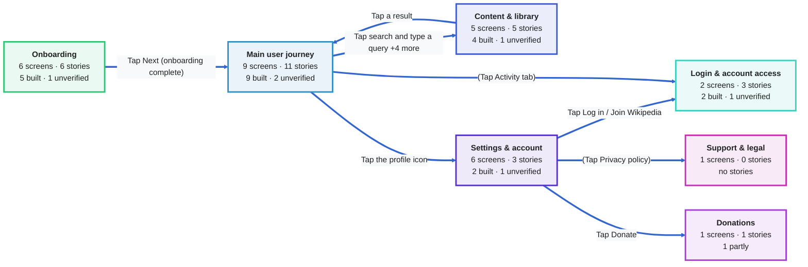
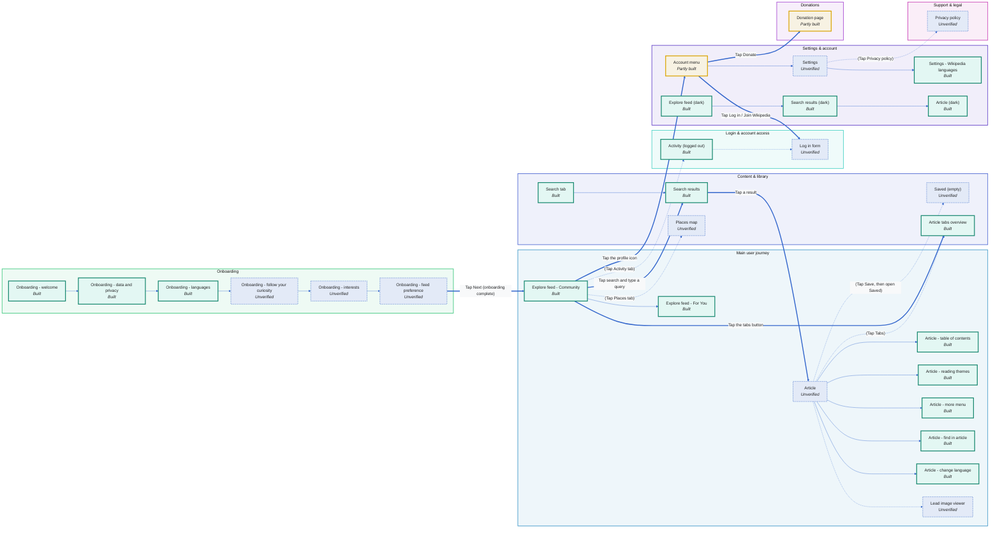
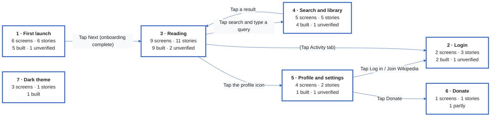
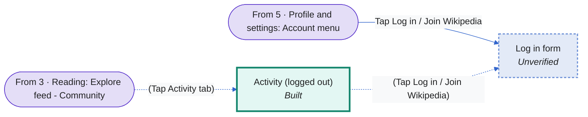
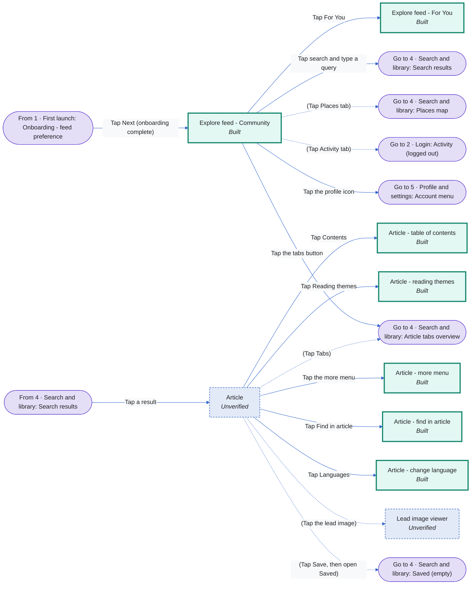
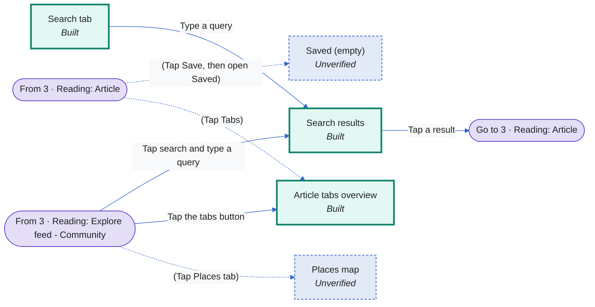
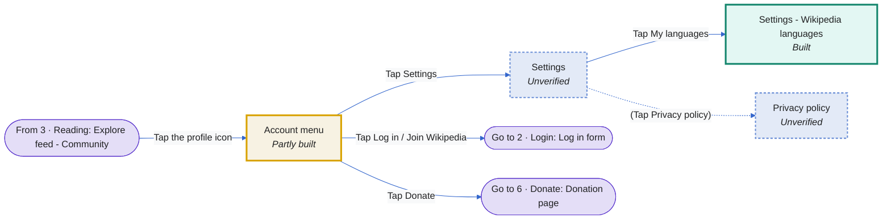
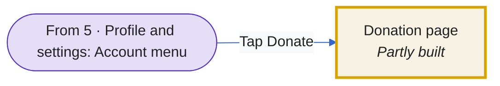

# Wikipedia (iOS) - story map

_Generated from `stories.yaml`. The diagrams below render on GitHub. Screens with real screenshots are in `flows/` (PNG) and `story-map.html`._

**ios · main @ ca8aaeb · checked 2026-10-15**

> Unofficial illustration of the open-source Wikipedia iOS app (MIT); not affiliated with or endorsed by the Wikimedia Foundation. Screenshots captured 2026-10-15 in the iOS simulator from commit ca8aaeb95639ca82105bcd5510277d8dde0e420e; trademarks and content belong to their owners (Wikipedia content CC BY-SA).

Status: 🟢 built · 🟠 partly · 🟣 unverified · ⚪ missing

## Architecture by topic

Each box is a topic area; arrows show how users move between them.

| Topic | Screens | Stories | 🟢 built | 🟠 partly | 🟣 unverified | ⚪ missing | Flows |
|---|---|---|---|---|---|---|---|
| **Onboarding** | 6 | 6 | 5 | 0 | 1 | 0 | 1 · First launch |
| **Login & account access** | 2 | 3 | 2 | 0 | 1 | 0 | 2 · Login |
| **Main user journey** | 9 | 11 | 9 | 0 | 2 | 0 | 3 · Reading |
| **Content & library** | 5 | 5 | 4 | 0 | 1 | 0 | 4 · Search and library |
| **Settings & account** | 6 | 3 | 2 | 0 | 1 | 0 | 5 · Profile and settings, 7 · Dark theme |
| **Donations** | 1 | 1 | 0 | 1 | 0 | 0 | 6 · Donate |
| **Support & legal** | 1 | 0 | 0 | 0 | 0 | 0 |  |

### Screens grouped by topic

## Story map (personas x flows)

| Persona | 1 · First launch | 2 · Login | 3 · Reading | 4 · Search and library | 5 · Profile and settings | 7 · Dark theme | 6 · Donate |
|---|---|---|---|---|---|---|---|
| **First-time user** | 🟢 US-01 🟢 US-02 🟢 US-04 🟢 US-05 🟣 US-06 |  |  |  |  |  |  |
| **Curious reader** |  | 🟢 US-09 | 🟢 US-07 🟢 US-11 🟢 US-12 🟢 US-13 🟢 US-14 🟢 US-15 🟢 US-16 🟣 US-18 🟢 US-19 | 🟢 US-20 🟢 US-21 🟢 US-24 🟣 US-25 | 🟣 US-29 | 🟢 US-27 | 🟠 US-28 |
| **Multilingual reader** | 🟢 US-03 |  | 🟢 US-17 |  | 🟢 US-26 |  |  |
| **Offline commuter** |  |  | 🟣 US-22 | 🟢 US-23 |  |  |  |
| **Contributor** |  | 🟢 US-08 🟣 US-10 |  |  |  |  |  |

## Flows overview

## 1 · First launch

Six onboarding pages, then the Explore feed.

```mermaid
%%{init: {"theme":"base","themeVariables":{"fontFamily":"Helvetica","fontSize":"16px","primaryColor":"#FFFFFF","primaryTextColor":"#202122","primaryBorderColor":"#3366CC","lineColor":"#3366CC","secondaryColor":"#F8F9FA","tertiaryColor":"#F0F2F4"}}}%%
flowchart LR
  n_ob_intro["Onboarding - welcome<br/><i>Built</i>"]:::built
  n_ob_privacy["Onboarding - data and privacy<br/><i>Built</i>"]:::built
  n_ob_languages["Onboarding - languages<br/><i>Built</i>"]:::built
  n_ob_personalize["Onboarding - follow your curiosity<br/><i>Unverified</i>"]:::unverified
  n_ob_interests["Onboarding - interests<br/><i>Unverified</i>"]:::unverified
  n_ob_feed["Onboarding - feed preference<br/><i>Unverified</i>"]:::unverified
  n_out_home(["Go to 3 · Reading: Explore feed - Community"]):::portal
  n_ob_intro -->|"Tap Next"| n_ob_privacy
  n_ob_privacy -->|"Tap Next"| n_ob_languages
  n_ob_languages -->|"Tap Next"| n_ob_personalize
  n_ob_personalize -->|"Tap Next"| n_ob_interests
  n_ob_interests -->|"Tap Next"| n_ob_feed
  n_ob_feed -->|"Tap Next (onboarding complete)"| n_out_home
  classDef built fill:#E3F7F3,stroke:#14866D,stroke-width:3px,color:#202122;
  classDef partly fill:#F7F2E3,stroke:#D9A300,stroke-width:3px,color:#202122;
  classDef unverified fill:#E3EAF7,stroke:#6B8FD6,stroke-width:2px,stroke-dasharray:4 3,color:#202122;
  classDef missing fill:#E3ECF7,stroke:#72777D,stroke-width:2px,stroke-dasharray:5 4,color:#202122;
  classDef portal fill:#E4DEF7,stroke:#5933CC,color:#202122;
```

## 2 · Login

Logged-out prompts that lead to the login form.

## 3 · Reading

From the Explore feed into an article and its tools.

## 4 · Search and library

Searching, tabs, saved pages, places, activity.

## 5 · Profile and settings

Profile menu, settings and languages.

## 7 · Dark theme

The same screens with the app theme set to dark.

```mermaid
%%{init: {"theme":"base","themeVariables":{"fontFamily":"Helvetica","fontSize":"16px","primaryColor":"#FFFFFF","primaryTextColor":"#202122","primaryBorderColor":"#3366CC","lineColor":"#3366CC","secondaryColor":"#F8F9FA","tertiaryColor":"#F0F2F4"}}}%%
flowchart LR
  n_dark_home["Explore feed (dark)<br/><i>Built</i>"]:::built
  n_dark_search_results["Search results (dark)<br/><i>Built</i>"]:::built
  n_dark_article["Article (dark)<br/><i>Built</i>"]:::built
  n_dark_home -->|"Tap search and type a query"| n_dark_search_results
  n_dark_search_results -->|"Tap a result"| n_dark_article
  classDef built fill:#E3F7F3,stroke:#14866D,stroke-width:3px,color:#202122;
  classDef partly fill:#F7F2E3,stroke:#D9A300,stroke-width:3px,color:#202122;
  classDef unverified fill:#E3EAF7,stroke:#6B8FD6,stroke-width:2px,stroke-dasharray:4 3,color:#202122;
  classDef missing fill:#E3ECF7,stroke:#72777D,stroke-width:2px,stroke-dasharray:5 4,color:#202122;
  classDef portal fill:#E4DEF7,stroke:#5933CC,color:#202122;
```

## 6 · Donate

The Donate row in the profile menu.

