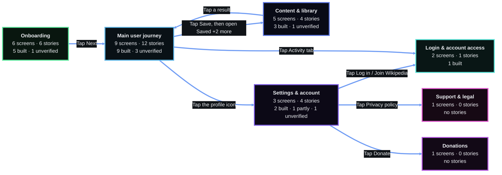
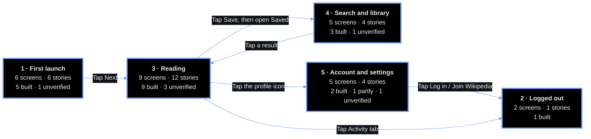
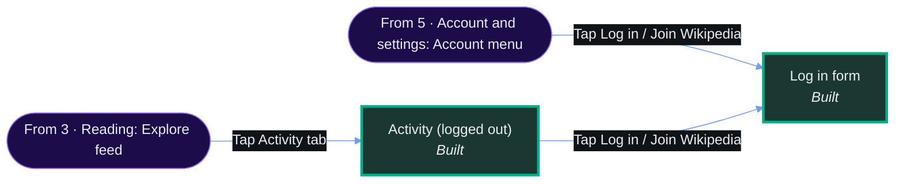
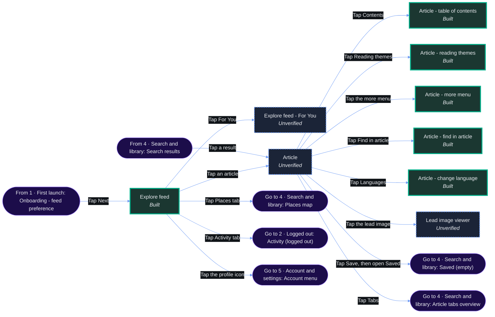
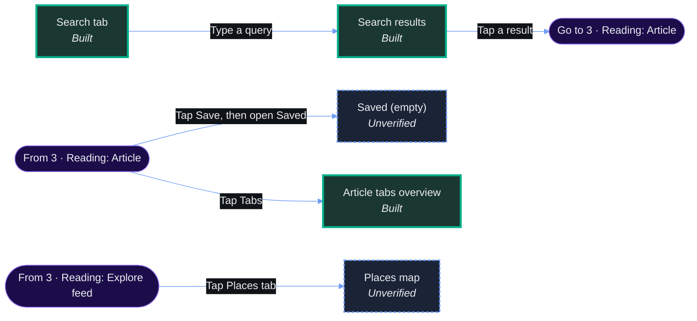
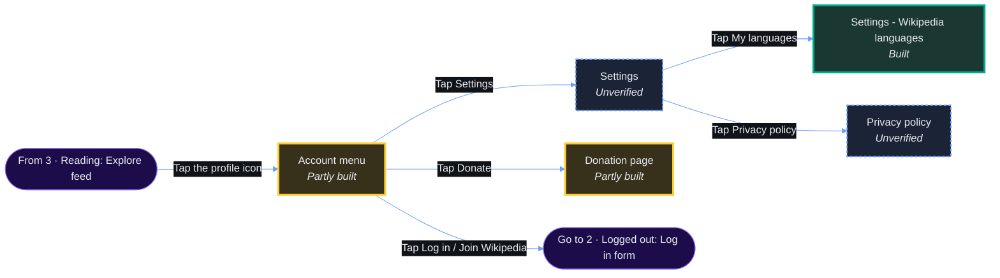

# Wikipedia (iOS) - story map

_Generated from `stories.yaml`. The diagrams below render on GitHub. Screens with real screenshots are in `flows/` (PNG) and `story-map.html`._

**ios · main @ ca8aaeb · checked 2026-10-15**

> Unofficial illustration of the open-source Wikipedia iOS app (MIT); not affiliated with or endorsed by the Wikimedia Foundation. Screenshots captured 2026-10-15 in the iOS simulator (app theme dark) from commit ca8aaeb95639ca82105bcd5510277d8dde0e420e; trademarks and content belong to their owners (Wikipedia content CC BY-SA).

Status: 🟢 built · 🟠 partly · 🟣 unverified · ⚪ missing

## Architecture by topic

Each box is a topic area; arrows show how users move between them.

| Topic | Screens | Stories | 🟢 built | 🟠 partly | 🟣 unverified | ⚪ missing | Flows |
|---|---|---|---|---|---|---|---|
| **Onboarding** | 6 | 6 | 5 | 0 | 1 | 0 | 1 · First launch |
| **Login & account access** | 2 | 1 | 1 | 0 | 0 | 0 | 2 · Logged out |
| **Main user journey** | 9 | 12 | 9 | 0 | 3 | 0 | 3 · Reading |
| **Content & library** | 5 | 4 | 3 | 0 | 1 | 0 | 4 · Search and library |
| **Settings & account** | 3 | 4 | 2 | 1 | 1 | 0 | 5 · Account and settings |
| **Donations** | 1 | 0 | 0 | 0 | 0 | 0 |  |
| **Support & legal** | 1 | 0 | 0 | 0 | 0 | 0 |  |

### Screens grouped by topic

```mermaid
%%{init: {"theme":"base","themeVariables":{"fontFamily":"Helvetica","fontSize":"16px","primaryColor":"#000000","primaryTextColor":"#EAECF0","primaryBorderColor":"#719DF4","lineColor":"#719DF4","secondaryColor":"#101418","tertiaryColor":"#1A1A1A"}}}%%
flowchart LR
  subgraph n_sg_onboarding["Onboarding"]
    direction TB
    n_ob_intro["Onboarding - welcome<br/><i>Built</i>"]:::built
    n_ob_privacy["Onboarding - data and privacy<br/><i>Built</i>"]:::built
    n_ob_languages["Onboarding - languages<br/><i>Built</i>"]:::built
    n_ob_personalize["Onboarding - follow your curiosity<br/><i>Unverified</i>"]:::unverified
    n_ob_interests["Onboarding - interests<br/><i>Unverified</i>"]:::unverified
    n_ob_feed["Onboarding - feed preference<br/><i>Unverified</i>"]:::unverified
  end
  subgraph n_sg_access["Login & account access"]
    direction TB
    n_login["Log in form<br/><i>Built</i>"]:::built
    n_activity["Activity (logged out)<br/><i>Built</i>"]:::built
  end
  subgraph n_sg_journey["Main user journey"]
    direction TB
    n_home["Explore feed<br/><i>Built</i>"]:::built
    n_foryou["Explore feed - For You<br/><i>Unverified</i>"]:::unverified
    n_article["Article<br/><i>Unverified</i>"]:::unverified
    n_article_toc["Article - table of contents<br/><i>Built</i>"]:::built
    n_article_theme["Article - reading themes<br/><i>Built</i>"]:::built
    n_article_overflow["Article - more menu<br/><i>Built</i>"]:::built
    n_article_find["Article - find in article<br/><i>Built</i>"]:::built
    n_article_languages["Article - change language<br/><i>Built</i>"]:::built
    n_gallery["Lead image viewer<br/><i>Unverified</i>"]:::unverified
  end
  subgraph n_sg_library["Content & library"]
    direction TB
    n_search["Search tab<br/><i>Built</i>"]:::built
    n_search_results["Search results<br/><i>Built</i>"]:::built
    n_saved["Saved (empty)<br/><i>Unverified</i>"]:::unverified
    n_tabs_overview["Article tabs overview<br/><i>Built</i>"]:::built
    n_places["Places map<br/><i>Unverified</i>"]:::unverified
  end
  subgraph n_sg_settings["Settings & account"]
    direction TB
    n_profile["Account menu<br/><i>Partly built</i>"]:::partly
    n_settings["Settings<br/><i>Unverified</i>"]:::unverified
    n_settings_languages["Settings - Wikipedia languages<br/><i>Built</i>"]:::built
  end
  subgraph n_sg_payments["Donations"]
    direction TB
    n_donate["Donation page<br/><i>Partly built</i>"]:::partly
  end
  subgraph n_sg_support["Support & legal"]
    direction TB
    n_privacy_policy["Privacy policy<br/><i>Unverified</i>"]:::unverified
  end
  n_ob_intro --> n_ob_privacy
  n_ob_privacy --> n_ob_languages
  n_ob_languages --> n_ob_personalize
  n_ob_personalize --> n_ob_interests
  n_ob_interests --> n_ob_feed
  n_ob_feed ==>|"Tap Next"| n_home
  n_profile ==>|"Tap Log in / Join Wikipedia"| n_login
  n_activity --> n_login
  n_home --> n_foryou
  n_home --> n_article
  n_article --> n_article_toc
  n_article --> n_article_theme
  n_article --> n_article_overflow
  n_article --> n_article_find
  n_article --> n_article_languages
  n_article --> n_gallery
  n_search --> n_search_results
  n_search_results ==>|"Tap a result"| n_article
  n_article ==>|"Tap Save, then open Saved"| n_saved
  n_article ==>|"Tap Tabs"| n_tabs_overview
  n_home ==>|"Tap Places tab"| n_places
  n_home ==>|"Tap Activity tab"| n_activity
  n_home ==>|"Tap the profile icon"| n_profile
  n_profile --> n_settings
  n_settings --> n_settings_languages
  n_settings ==>|"Tap Privacy policy"| n_privacy_policy
  n_profile ==>|"Tap Donate"| n_donate
  style n_sg_onboarding fill:#07120C,stroke:#5AE299,stroke-width:2px
  style n_sg_access fill:#071211,stroke:#5AE2D6,stroke-width:2px
  style n_sg_journey fill:#070E12,stroke:#5AB2E2,stroke-width:2px
  style n_sg_library fill:#070912,stroke:#5A75E2,stroke-width:2px
  style n_sg_settings fill:#090712,stroke:#7B5AE2,stroke-width:2px
  style n_sg_payments fill:#0E0712,stroke:#B75AE2,stroke-width:2px
  style n_sg_support fill:#120710,stroke:#E25AD0,stroke-width:2px
  classDef built fill:#1B3731,stroke:#00AF89,stroke-width:3px,color:#EAECF0;
  classDef partly fill:#37301B,stroke:#FFCC33,stroke-width:3px,color:#EAECF0;
  classDef unverified fill:#1B2437,stroke:#6699FF,stroke-width:2px,stroke-dasharray:4 3,color:#EAECF0;
  classDef missing fill:#1B2837,stroke:#A2A9B1,stroke-width:2px,stroke-dasharray:5 4,color:#EAECF0;
  classDef portal fill:#1C0D4A,stroke:#9271F4,color:#EAECF0;
```

## Story map (personas x flows)

| Persona | 1 · First launch | 2 · Logged out | 3 · Reading | 4 · Search and library | 5 · Account and settings |
|---|---|---|---|---|---|
| **First-time user** | 🟢 US-01 🟢 US-02 🟢 US-04 🟢 US-05 🟣 US-06 |  |  |  |  |
| **Curious reader** |  | 🟢 US-09 | 🟢 US-07 🟢 US-10 🟣 US-11 🟢 US-12 🟢 US-13 🟢 US-14 🟢 US-15 🟢 US-17 🟣 US-18 🟢 US-25 | 🟢 US-19 🟢 US-22 🟣 US-23 | 🟢 US-08 🟠 US-26 🟣 US-27 |
| **Multilingual reader** | 🟢 US-03 |  | 🟢 US-16 |  | 🟢 US-24 |
| **Offline commuter** |  |  | 🟣 US-20 | 🟢 US-21 |  |

## Flows overview

## 1 · First launch

Six onboarding pages, then the Explore feed.

## 2 · Logged out

Account prompts that lead to the login form.

## 3 · Reading

From the Explore feed into an article and its reading tools.

## 4 · Search and library

Searching, saved pages, tabs and places.

## 5 · Account and settings

Profile menu, settings, languages, legal links.

